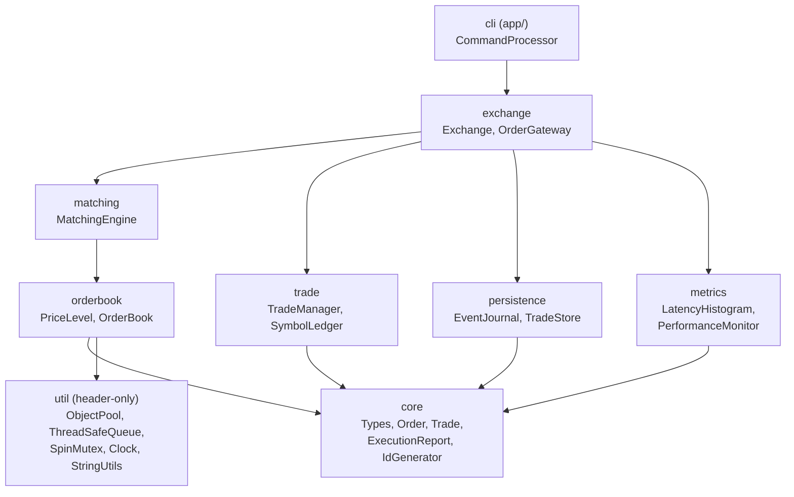
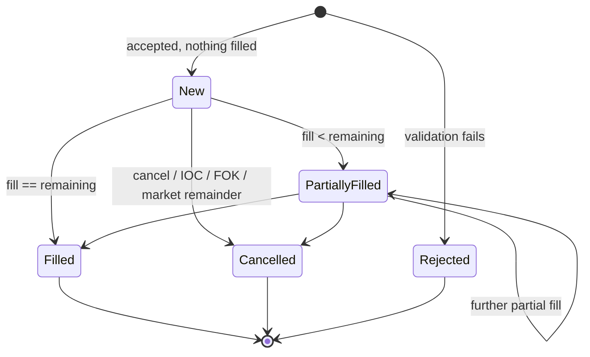
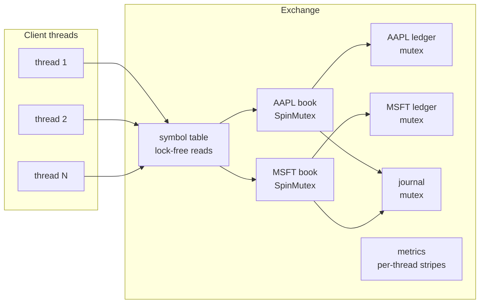

# MiniExchange: Architecture and Design

This document explains how the engine is put together and why. The source
headers carry the same reasoning next to the code.

## 1. Module structure

Every module is its own static library (`src/CMakeLists.txt`), so the
dependency graph is enforced by the build: a lower layer cannot include a
higher one.



| Module | Responsibility |
|---|---|
| **Order management** (`core`) | `OrderRequest`, validation, `Order` value type and its lifecycle, id generation |
| **Order book** (`orderbook`) | Bid/ask price levels, FIFO queues, id index, depth snapshots; a pure data structure |
| **Matching engine** (`matching`) | Price-time priority algorithm, market/limit/IOC/FOK semantics, trade creation |
| **Trade management** (`trade`) | Transaction record (ledger), per-symbol statistics (OHLC, volume, VWAP), trade listeners |
| **Exchange management** (`exchange`) | Thread-safe facade: symbols, ids, validation, locking, journaling, async gateway |
| **Persistence** (`persistence`) | Write-ahead event journal and crash recovery, CSV trade export/import |
| **Performance monitoring** (`metrics`) | Lock-free latency histograms, throughput counters, RAII `ScopedTimer` |

## 2. Order lifecycle



An `ExecutionReport` always satisfies
`quantity == filledQuantity + restingQuantity + cancelledQuantity`, and the
tests check this invariant for every order they submit.

## 3. Order book data structures

```
OrderBook("AAPL")
 ├── bids_: std::map<Price, PriceLevel, std::greater>   best = begin() = highest
 ├── asks_: std::map<Price, PriceLevel, std::less>      best = begin() = lowest
 ├── index_: std::unordered_map<OrderId, Pool::Ptr>     owns every resting order
 └── pool_:  ObjectPool<OrderNode>                      recycled storage

PriceLevel(150.25)                     OrderNode
 head ─► [#2 carol 50] ◄──► [#3 dave 70] ◄─ tail      { Order order; prev; next; level }
 totalQuantity = 120, orderCount = 2
```

* **Prices are integers** (`int64` ticks, 1 tick = 0.01). Comparisons are
  exact and there is no floating-point drift in priority decisions.
  `parsePrice`/`formatPrice` convert text without ever using a `double`.
* **Price priority**: each side is a `std::map` (red-black tree) ordered so
  that `begin()` is always the best price, which makes best bid/ask O(1).
* **Time priority**: each `PriceLevel` is an intrusive doubly linked FIFO.
  New orders go to the tail and matching takes from the head. Because the links
  live inside the node, append, pop-front and *cancel from the middle* are all
  O(1) and allocation-free. A partially filled order keeps its place.
* **O(1) cancel**: the `index_` hash map finds the node, and the node knows its
  level, so it unlinks itself without searching.

| Operation | Complexity |
|---|---|
| Add to an existing level | O(log P) + O(1) |
| Add creating a new level | O(log P) |
| Cancel | O(1) average, + O(log P) if the level empties |
| Best bid / ask | O(1) |
| Match one fill | O(1), + O(log P) if a level empties |
| Depth snapshot of k levels | O(k) |

P is the number of distinct price levels on one side.

## 4. Matching algorithm (price-time priority)

`MatchingEngine::process(Order)` for an incoming **buy** (sell is symmetric):

1. **Defensive validation**: symbol, open quantity, positive limit price,
   unique id. Bad orders are reported as `Rejected` and never touch the book.
2. **Fill-or-kill pre-check**: sum the ask liquidity priced `<= limit` (any
   price for market FOK), stopping early once the target is reached. If it's
   short, the order is cancelled and the book is unchanged.
3. **Match loop**: while quantity remains and the best ask crosses
   (`ask <= limit`, or always for a market order), trade
   `min(remaining, resting.remaining)` with the **oldest** order at the
   **best** price. The trade executes at the **resting order's price**: the
   maker sets the price and the taker gets any price improvement.
4. **Remainder**: GTC limit orders rest in the book. IOC, FOK and market
   orders have the remainder cancelled; market orders can never rest.

The trade is built *before* `OrderBook::fill`, because a fully filled resting
node is returned to the pool inside `fill`.

**How correctness is verified**: `tests/test_reference_model.cpp` runs 5
seeded streams of 4,000 random operations (limit, market, IOC, FOK, cancel)
through both the optimised engine and a deliberately naive O(n) reference
model. It asserts that every trade, and the final aggregated book, is identical.

## 5. Memory management

* **ObjectPool + RAII handles**: resting orders live in `OrderNode`s carved
  from 4,096-slot chunks, and a free list recycles them. Handles are
  `std::unique_ptr<OrderNode, Pool::Deleter>`, so ownership is explicit and an
  order returns to the pool automatically when its index entry is erased.
  Steady-state trading makes no heap calls for book nodes: the benchmark measures
  about 55M allocations per second against about 11M for `new`/`delete`.
* **Ownership is in one place**: the `index_` map owns the nodes. The price
  level lists hold non-owning raw pointers, which is safe because a node is
  always unlinked before its owner is destroyed.
* **Destruction order is deliberate**: `pool_` is declared *before* `index_`,
  so it is destroyed *after* every handle has returned its node.
* **Strong exception guarantee** in `OrderBook::add` and `ObjectPool::make`: on
  failure the book or pool is left unchanged.
* **No raw `new`/`delete`** anywhere in the code base. Every resource
  (threads, files, locks, pooled objects) is owned by an RAII type.

## 6. Concurrency model



| Shared state | Protection | Why |
|---|---|---|
| Symbol table | Open-addressing table of `std::atomic<SymbolBook*>`; writer mutex for `addSymbol` | Every order looks up its symbol, so reads must not write any shared cache line. Symbols are never removed, so a published pointer stays valid. |
| Order book + engine | One `SpinMutex` per symbol | Same-symbol orders must be serialised (that is what time priority means); different symbols run fully in parallel. The critical section is about 300 ns, so spinning hands over faster than sleeping. |
| Trade ledger | One mutex per symbol (lock striping) | Recording never contends across symbols. |
| Order / trade ids | `std::atomic` `fetch_add` (relaxed) | Unique ids need atomicity only. |
| Metrics | 16 cache-line-aligned stripes, one per thread | Shared counters were measured to stop the engine scaling (see BENCHMARKS.md). |
| Trade listeners | Copy-on-write `shared_ptr<const vector>` | Notification never holds a lock while running user code. |

**Lock ordering** is always *registry writer, then symbol book, then
{ledger, journal}*. No path acquires them in reverse, so deadlock is
impossible. Listeners run **after** the book lock is released, so a
listener may call back into the exchange. A test proves this
(`ListenersRunOutsideTheBookLock`).

**`OrderGateway`** (async front end): requests are sharded by
`hash(symbol) % workers` onto per-worker `ThreadSafeQueue`s (mutex + condition
variable). One symbol is always processed by one worker in submission order,
which is the single-writer-per-instrument model real exchanges use. Results
come back as `std::future`s from `std::packaged_task`, so exceptions propagate
to the caller. The destructor drains the queues and joins the threads (RAII).

The concurrency tests check, after 8 threads trade 4 symbols at random, that
every unit of every order is accounted for:
`original = traded + cancelled + still resting`. They also check that trade ids
are unique, that no book is crossed, and that the gateway preserves
per-symbol order. CI runs them under **ThreadSanitizer**.

## 7. Persistence and recovery

**Write-ahead journal** (`EventJournal`): every accepted command is appended
*before* it is applied, while the symbol lock is held, so the per-symbol
journal order is exactly the order the engine saw:

```
# MiniExchange journal v1
S,AAPL
N,1,1794859071895009800,AAPL,SELL,LIMIT,GTC,25000,100,bob
N,2,1794859071895321700,AAPL,BUY,LIMIT,GTC,25000,30,alice
C,1,1794859071899000000,AAPL
```

`Exchange::recover(path)` replays the events through the same deterministic
engine (**event sourcing**). Trades are stamped with the aggressor's journaled
arrival time, so a replay rebuilds books **and** trades bit-for-bit,
timestamps included. The order id generator is advanced past every recovered
id. A torn final line, as left by a crash mid-write, is skipped and counted
instead of aborting recovery. Rejected orders are never journaled.

**Transaction records**: `writeTradesCsv`/`readTradesCsv` export and import
the trade ledger as spreadsheet-friendly CSV, with decimal prices parsed back
exactly.

## 8. Performance monitoring

`LatencyHistogram` is a log-linear histogram (HdrHistogram-style). Values 0 to 15
are exact, and each higher power of two is split into 16 linear buckets. That
gives at most 6.25% relative error over the full 64-bit range in a fixed 976
counters. `record()` is wait-free (relaxed `fetch_add`). `PerformanceMonitor`
keeps one histogram set per thread stripe and merges them when you call
`snapshot()`. `ScopedTimer` records a scope's duration on destruction (RAII).

## 9. Validation and error handling

* Requests are validated in one place (`validationError`): symbol format,
  trader id format, quantity in `[1, 1e9]`, limit price in `(0, 1e9]`.
  Because identifiers are restricted to `[A-Za-z0-9._-]`, the CSV and journal
  formats need no quoting.
* Business errors (unknown symbol, invalid order, nothing to cancel) are
  returned in `ExecutionReport` / `CancelResult`, never thrown.
* Programming errors (overfilling an order, adding a market order to the
  book) throw `std::invalid_argument` / `std::logic_error`.
* I/O failures (cannot open or write a file) throw `std::runtime_error`.

## 10. Limitations and possible extensions

* Order amendment (cancel/replace) and stop orders are not implemented.
* No self-trade prevention: an order may match the same trader's resting order.
* Contended same-symbol throughput is bounded by the per-book lock. The
  `OrderGateway` single-writer model is the scalable way to feed one hot symbol.
* Trades and the journal are local files. A networked gateway (FIX/TCP) and
  market data publication would be natural next steps.
* Benchmarks were run on Windows/MinGW. Linux (glibc) numbers are usually
  higher for the mutex- and condition-variable-heavy paths.
